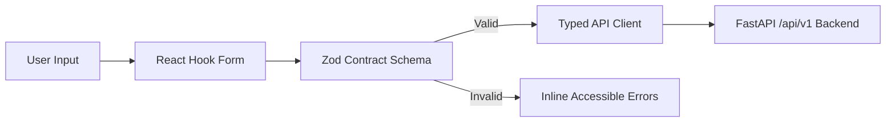

# BaselineGuard (formerly CISGuard 360) - Component Architecture & Visualization Plan
**Role:** Frontend Owner (Apoorva)  
**Date:** October 29, 2026  
**Document Status:** Complete Phase 0 Component Specifications & Design System Plan  

---

## 1. Design System & Cybersecurity Design Tokens

The BaselineGuard interface employs a **dark-first, high-density, accessible cybersecurity aesthetic** designed for Security Operations Center (SOC) environments and audit engineering workflows.

### 1.1 Color Tokens & Semantic States

| Token Name | Hex Code | Purpose / Context |
| :--- | :--- | :--- |
| `bg-background` | `#0b0f17` | Root background; deep slate-black reducing eye strain in low-light SOC |
| `bg-card` | `#111827` | Surface cards, tables, panels, and modals |
| `bg-card-hover` | `#1a2234` | Hover/active states on cards and rows |
| `border-border` | `#1f293d` | High-contrast structural dividers and card outlines |
| `text-primary` | `#f1f5f9` | Primary headings, values, table text |
| `text-secondary`| `#94a3b8` | Subtitles, labels, metadata, inactive links |
| `text-muted` | `#64748b` | Disabled text, subtle hints, code comments |
| `status-pass` | `#10b981` (Emerald-500) | Successful compliance, verified service probe, safe contract |
| `status-fail` | `#ef4444` (Rose-500) | Non-compliant control, failed service probe, contract violation |
| `status-not-applicable` | `#6b7280` (Gray-500) | Control excluded from denominator |
| `status-manual-review` | `#f59e0b` (Amber-500) | Awaiting human attestation/evidence |
| `status-error` | `#dc2626` (Red-600) | Assessment execution failure (never counted as PASS) |
| `status-not-assessed` | `#8b5cf6` (Purple-500) | Missing collector or unsupported capability (never counted as PASS) |
| `status-exception` | `#38bdf8` (Sky-400) | Policy-approved time-bound exception overlay |
| `severity-critical` | `#f43f5e` (Rose-600) | CVSS 9.0–10.0 / Immediate compromise vector |
| `severity-high` | `#ea580c` (Orange-600) | CVSS 7.0–8.9 / Privileged exposure, clear bypass |
| `severity-medium` | `#eab308` (Yellow-500) | CVSS 4.0–6.9 / Weak configuration, limited exposure |
| `severity-low` | `#3b82f6` (Blue-500) | CVSS 0.1–3.9 / Best practice deviation |

---

## 2. Reusable Component Gallery Specification

As mandated in the Playbook (Page 4), the application implements 10 foundational reusable components:

### 2.1 `StatCard`
- **Purpose**: Displays high-level KPIs (e.g., Assessed Compliance %, Assessment Coverage %, Active Scans, High-Risk Findings).
- **Props**:
  - `title: string`
  - `value: string | number`
  - `change?: { value: number; trend: 'up' | 'down' | 'neutral'; period: string }`
  - `badge?: { text: string; variant: 'success' | 'warning' | 'destructive' | 'outline' }`
  - `icon: LucideIcon`
  - `tooltip?: string`
  - `loading?: boolean`
- **Accessibility**: ARIA label linking value to title, semantic `role="status"`.

### 2.2 `SeverityBadge`
- **Purpose**: Standardized visual pill for Critical, High, Medium, Low severities.
- **Props**:
  - `severity: 'CRITICAL' | 'HIGH' | 'MEDIUM' | 'LOW' | 'INFORMATIONAL'`
  - `variant?: 'solid' | 'subtle' | 'outline'`
  - `size?: 'sm' | 'md' | 'lg'`
  - `count?: number`

### 2.3 `EvidenceViewer`
- **Purpose**: Displays raw, immutable evidence references collected from devices (M12, M14, M15).
- **Features**:
  - SHA256 integrity hash verification pill (green if valid, red if mismatch).
  - Sanitized CLI / API command output syntax box with line numbering.
  - Timestamp, collection method (`ssh`, `winrm`, `rest_api`, `offline_fixture`), and collector version badge.
  - Copy command button (read-only; no client execution).

### 2.4 `ConfigDiff`
- **Purpose**: Side-by-side or unified diff viewer for configuration changes (M09, M36, E06, E20, E22).
- **Features**:
  - Red / Green syntax highlighting for deletions and additions.
  - Chunk folding for unchanged lines.
  - Word-level diff markers.
  - Line numbers matching exact device configuration coordinates.

### 2.5 `ControlResult`
- **Purpose**: Displays single control evaluation outcome (M16, M36).
- **Features**:
  - Clear status chip: `PASS`, `FAIL`, `NOT_APPLICABLE`, `MANUAL_REVIEW`, `ERROR`, `NOT_ASSESSED`.
  - Exception overlay pill if an approved time-bound exception is active.
  - Expected value vs Observed value side-by-side comparison.
  - Link to relevant rule definition in the Policy Library.

### 2.6 `DataTable`
- **Purpose**: High-performance virtualized table powered by `@tanstack/react-table`.
- **Features**:
  - Multi-column sort, global and column-specific filters.
  - Cursor-based or page-based pagination.
  - Row selection for bulk actions (e.g., bulk scan launch, export).
  - Column visibility toggle and density switch (Compact / Comfortable).
  - Full keyboard navigation with arrow keys and Enter/Space.

### 2.7 `EmptyState`
- **Purpose**: Displayed when no data exists (e.g. 0 assets, 0 findings, 0 scans).
- **Props**:
  - `icon: LucideIcon`
  - `title: string`
  - `description: string`
  - `action?: { label: string; onClick: () => void; icon?: LucideIcon }`

### 2.8 `ConfirmDialog`
- **Purpose**: High-risk action verification modal (E18, E21, E23).
- **Features**:
  - Explicit warning message detailing potential impact or loss-of-access risk.
  - Require user to type a confirmation phrase (e.g. `EXECUTE HARDENING` or device hostname).
  - Destructive action style with red button and clear cancel button.

### 2.9 `Timeline`
- **Purpose**: Chronological event tracker for scan runs, change executions, and configuration drift (E05, E19, I10).
- **Features**:
  - State nodes connected by vertical/horizontal progress bars.
  - Step statuses: `PENDING`, `IN_PROGRESS`, `SUCCESS`, `FAILED`, `CANCELLED`.
  - Timestamp, actor name, and event duration.

### 2.10 `RiskPath`
- **Purpose**: Visual pathway illustrating correlated misconfigurations across multiple hops (I01, I02, I05).
- **Features**:
  - Node sequence: `[External / Ingress] -> [Firewall ACL Failure] -> [Switch VLAN 1] -> [Endpoint SSH Weakness]`.
  - Edge labels displaying port and protocol.
  - Expandable evidence cards per hop.

---

## 3. Complex Interactive Visualizations

### 3.1 Cytoscape.js Cross-Layer Security Graph (`/orgs/:orgId/graph`)
- **Technology**: `cytoscape` + `react-cytoscapejs` with Cola or CoSE layout engine.
- **Node Taxonomy**:
  - `AssetNode`: Device icon, hostname, platform, overall status.
  - `InterfaceNode`: IP address, MAC, MTU, switchport mode.
  - `SubnetNode`: CIDR block, VLAN ID, zone.
  - `ServiceNode`: Port, protocol (e.g., `22/tcp`, `443/tcp`).
  - `FindingNode`: Control ID, severity pill.
- **Edge Taxonomy**:
  - `hosted_on`: Interface belongs to Asset.
  - `attached_to`: Interface connects to Subnet/Switchport.
  - `routes_to`: Routing path between subnets.
  - `allows_traffic`: Firewall/ACL permit relation (solid line).
  - `denies_traffic`: Firewall/ACL deny relation (dashed line).
  - `violates`: Finding linked to Asset/Interface (highlighted red/orange).
- **Interactive Controls**:
  - Zoom to fit, reset viewport, lasso selection.
  - Path finder: select source and target node to compute reachable paths (`I03`).
  - Edge confidence filter: show only confirmed vs suspected topology.
- **Accessibility Fallback**: A full, keyboard-navigable TanStack table alternative displaying all node relationships and path vectors.

### 3.2 React Flow Remediation Sequencing DAG (`/orgs/:orgId/planner/:id`)
- **Technology**: `@xyflow/react` (`v12+`).
- **Node Types**:
  - `CandidateActionNode`: Vendor CLI snippet, target asset, risk weight, prerequisite count.
  - `StageGateNode`: Approval checkpoint, backup snapshot verification, canary pause.
  - `ContractVerificationNode`: Service-safety contract probe check.
- **Edge Semantics**:
  - Strict dependency sequence: Step A must complete before Step B to prevent network lockout (`I10`).
  - Conflict edges highlighted in dashed red (`I09`).
- **Interactive Workflow**:
  - Drag-and-drop sequencing within allowed dependency boundaries.
  - Click node to open dry-run diff previewer and prerequisite checklist (`E22`).

### 3.3 Recharts Analytics Suite (`/orgs/:orgId/overview`, `/reports`)
- **Compliance vs Coverage Gauge & Trend**:
  - Dual line chart comparing Assessed Compliance % against Assessment Coverage % over time (`E07`).
  - Invariant enforcement: charts show raw server-computed numbers with zero client-side smoothing or fabrication.
- **Severity Distribution Donut**:
  - Donut chart slicing findings by Critical, High, Medium, Low severities.
  - Centered aggregate finding count.
- **Asset Type Stacked Bar Chart**:
  - Breakdown of pass/fail/error/not_assessed controls across Windows, Linux, Firewall, and Switch platforms.

---

## 4. Form Schemas & Runtime Validation Strategy

All interactive forms are powered by **React Hook Form** with **Zod** schema validation, ensuring strict client-side validation that mirrors the frozen `contracts/v1` rules:

### Key Forms:
1. **Audit Launch Wizard**: Scope selection, policy pack UUID, profile (Level 1/Level 2), read-only confirmation checkbox (`E08`, `E11`, `E18`).
2. **Custom Baseline Override**: Threshold numeric limits, enabled rule array, justification string (`M18`).
3. **Policy Exception Request**: Finding UUID, expiration timestamp (ISO 8601), reason, approver email (`E14`).
4. **Service-Safety Contract**: Source CIDR, destination CIDR, required port/protocol, contract action (`I12`).
5. **Approval Sign-Off**: Plan hash verification, confirmation checkbox, separation-of-duties check (`E23`).

---

## 5. Supabase Auth & Realtime Synchronization Architecture

- **Session Handling**: `@supabase/supabase-js` manages OAuth/password session tokens stored in secure `localStorage`.
- **Bearer Token Forwarding**: Every request issued by the typed API client injects the `Authorization: Bearer <supabase_access_token>` header.
- **Realtime Dashboard Updates**:
  - Supabase Realtime channel subscribed to `audit_jobs`, `changes`, and `notifications` tables.
  - When Realtime events fire, TanStack Query cache is automatically invalidated using `queryClient.invalidateQueries({ queryKey: [...] })`.
  - Fallback: Reliable exponential-backoff polling (every 5 seconds) if WebSockets disconnect.

