# BaselineGuard (formerly CISGuard 360) - Route Map & 88-Feature Screen Matrix

Phase 9 audit: the mapping below is a planned screen responsibility map, not a DONE
matrix or a claim that its proposed hooks/endpoints exist. Current evidence statuses
are in [feature-coverage.md](feature-coverage.md); the actual 19-family source/state
audit is in [phase8-review.md](phase8-review.md). System States is now reachable from
owner/admin navigation. Offline import and worker health remain unimplemented.
**Role:** Frontend Owner (Apoorva)  
**Date:** October 29, 2026  
**Document Status:** Complete Phase 0 Route Taxonomy & Feature Binding  
**Scope:** 88 Features (M01–M38, E01–E30, I01–I20) across 19 Screen Families  

---

## 1. Application Architecture & Route Layout Hierarchy

The application utilizes a multi-tier nested routing model with strict tenant isolation, RBAC route guards, and standardized error/state boundaries.

```mermaid
flowchart TD
    Root["/ (Root Layout & Global Providers)"] --> PublicRoute["Public Boundary"]
    Root --> ProtectedRoute["Protected Tenant Boundary (Supabase Auth + Session Guard)"]

    PublicRoute --> Auth["/auth/*"]
    Auth --> Login["/auth/login"]
    Auth --> Invite["/auth/invite/:token"]
    Auth --> ResetPwd["/auth/reset-password"]
    Auth --> MFA["/auth/mfa-challenge"]
    Auth --> Blocked["/auth/blocked"]

    ProtectedRoute --> OrgSelect["/orgs (Tenant Context Picker)"]
    ProtectedRoute --> AppLayout["/orgs/:orgId (Main Dashboard Layout)"]

    AppLayout --> NavOverview["/overview"]
    AppLayout --> NavAssets["/assets/*"]
    AppLayout --> NavScans["/scans/*"]
    AppLayout --> NavPolicies["/policies/*"]
    AppLayout --> NavExceptions["/exceptions/*"]
    AppLayout --> NavFindings["/findings/*"]
    AppLayout --> NavGraph["/graph"]
    AppLayout --> NavRisk["/risk-scenarios/*"]
    AppLayout --> NavPlanner["/planner/*"]
    AppLayout --> NavSimulator["/simulator/*"]
    AppLayout --> NavHardening["/hardening/*"]
    AppLayout --> NavVerification["/verification/*"]
    AppLayout --> NavReports["/reports/*"]
    AppLayout --> NavIntegrations["/integrations/*"]
    AppLayout --> NavAdmin["/admin/*"]
```

---

## 2. Exhaustive Route Map (19 Screen Families)

| # | Screen Family | Route Path | Dynamic Params | Auth Guard & Min RBAC | Core UI Components / Views |
| :- | :--- | :--- | :--- | :--- | :--- |
| **01** | **Authentication** | `/auth/login` | None | Public | Email/Password form, Magic Link trigger, Error alert |
| | | `/auth/invite/:token` | `:token` | Public | Invite validation, account creation form |
| | | `/auth/reset-password` | None | Public | Password reset request & update views |
| | | `/auth/mfa-challenge` | None | Authenticated (MFA Pending) | TOTP 6-digit challenge code input, recovery code fallback |
| | | `/auth/mfa-setup` | None | Authenticated | QR code display, TOTP verification, recovery codes |
| | | `/auth/blocked` | None | Public / Auth | Tenant suspension notice, IP restriction details |
| **02** | **Org Selection** | `/orgs` | None | Authenticated | Tenant switcher cards, role badges, workspace creation modal |
| **03** | **Main Overview** | `/orgs/:orgId/overview` | `:orgId` | Authenticated (Viewer) | Dual score cards (Compliance % vs Coverage %), Severity donut, Asset health grid, Scan queue ticker, Trend chart |
| **04** | **Asset Inventory** | `/orgs/:orgId/assets` | `:orgId` | Authenticated (Viewer) | Paginated TanStack table, search input, tag filters, platform badges, quick scan button |
| | | `/orgs/:orgId/assets/discover` | `:orgId` | Authenticated (Operator) | CIDR subnet boundary form, port selector, live discovery preview, scope confirmation |
| | | `/orgs/:orgId/assets/import` | `:orgId` | Authenticated (Operator) | CSV/JSON bulk import, offline config uploader (DEMO mode) |
| **05** | **Asset Details** | `/orgs/:orgId/assets/:assetId` | `:orgId`, `:assetId` | Authenticated (Viewer) | System overview, hardware/OS version, masked vault credentials reference |
| | | `/orgs/:orgId/assets/:assetId/interfaces` | `:orgId`, `:assetId` | Authenticated (Viewer) | L2/L3 interface table, IP/MAC, VLAN assignments, port security status |
| | | `/orgs/:orgId/assets/:assetId/findings` | `:orgId`, `:assetId` | Authenticated (Viewer) | Scoped findings table, status filters, expected vs actual diff |
| | | `/orgs/:orgId/assets/:assetId/snapshots` | `:orgId`, `:assetId` | Authenticated (Viewer) | Versioned config history, SHA256 integrity check, diff viewer |
| **06** | **Scan Center** | `/orgs/:orgId/scans` | `:orgId` | Authenticated (Viewer) | Active jobs list, historical scans table, status badges, retry trigger |
| | | `/orgs/:orgId/scans/new` | `:orgId` | Authenticated (Operator) | Multi-target audit launcher wizard, policy pack selector, profile level toggle, read-only confirmation |
| | | `/orgs/:orgId/scans/:scanId` | `:orgId`, `:scanId` | Authenticated (Viewer) | Real-time scan progress bar, per-device status stream, error isolation logs |
| | | `/orgs/:orgId/scans/schedules` | `:orgId` | Authenticated (Operator) | Cron schedule manager, recurring scan targets, next-run tracker |
| **07** | **Policy Library** | `/orgs/:orgId/policies` | `:orgId` | Authenticated (Viewer) | Benchmark packs list (CIS, custom), profile cards (L1/L2), active status |
| | | `/orgs/:orgId/policies/:policyId` | `:orgId`, `:policyId` | Authenticated (Viewer) | Policy details, rule tree, applicability filters, metadata |
| | | `/orgs/:orgId/policies/:policyId/rules/:ruleId` | `:orgId`, `:policyId`, `:ruleId` | Authenticated (Viewer) | Rule logic inspector, expected state schema, evaluation operator, remediation CLI template |
| | | `/orgs/:orgId/policies/:policyId/overrides` | `:orgId`, `:policyId` | Authenticated (Admin) | Custom baseline editor, threshold sliders, override audit trail |
| | | `/orgs/:orgId/policies/upgrade-preview` | `:orgId` | Authenticated (Admin) | Benchmark version diff (added, modified, removed rules), affected asset impact analysis |
| **08** | **Exceptions & Reviews** | `/orgs/:orgId/exceptions` | `:orgId` | Authenticated (Auditor) | Time-boxed exceptions list, expiry countdown, approver metadata, revoked status |
| | | `/orgs/:orgId/exceptions/new` | `:orgId` | Authenticated (Auditor) | Exception request dialog, finding selector, justification, expiry picker |
| | | `/orgs/:orgId/manual-reviews` | `:orgId` | Authenticated (Auditor) | Human attestation queue, manual evidence uploader, sign-off controls |
| **09** | **Findings Explorer** | `/orgs/:orgId/findings` | `:orgId` | Authenticated (Viewer) | Global findings TanStack Table, multi-faceted filtering (severity, asset, status, benchmark), bulk export |
| | | `/orgs/:orgId/findings/:findingId` | `:orgId`, `:findingId` | Authenticated (Viewer) | Side-by-side expected vs actual comparison panel, raw evidence reference viewer, remediation preview, exception drawer |
| **10** | **Security Graph** | `/orgs/:orgId/graph` | `:orgId` | Authenticated (Viewer) | Cytoscape.js interactive topology canvas, typed node/edge inspector, path trace drawer, keyboard table fallback |
| **11** | **Risk Scenarios** | `/orgs/:orgId/risk-scenarios` | `:orgId` | Authenticated (Viewer) | Correlated scenario cards, risk score ranking, business impact summary |
| | | `/orgs/:orgId/risk-scenarios/:scenarioId` | `:orgId`, `:scenarioId` | Authenticated (Viewer) | Root-cause causal chain diagram, source findings list, affected assets table, explainability confidence score |
| **12** | **Remediation Planner** | `/orgs/:orgId/planner` | `:orgId` | Authenticated (Operator) | Vetted candidate alternatives list, OR-Tools CP-SAT impact scores, constraint violation alerts |
| | | `/orgs/:orgId/planner/:planId` | `:orgId`, `:planId` | Authenticated (Operator) | React Flow sequence DAG, stage gates, dependency conflict matrix, approval submission modal |
| **13** | **What-If Simulator** | `/orgs/:orgId/simulator` | `:orgId` | Authenticated (Operator) | Simulation job list, Batfish model coverage indicators, verdict overview |
| | | `/orgs/:orgId/simulator/:simId` | `:orgId`, `:simId` | Authenticated (Operator) | Baseline vs Candidate comparison view, traffic contract verdicts, blast-radius asset map |
| | | `/orgs/:orgId/simulator/contracts` | `:orgId` | Authenticated (Operator) | Service-safety contract editor, mandatory traffic preservation rules |
| **14** | **Approvals & Hardening** | `/orgs/:orgId/approvals` | `:orgId` | Authenticated (Approver) | Multi-role approval queue, separation-of-duties enforcement, plan diff summary, backup verification |
| | | `/orgs/:orgId/changes` | `:orgId` | Authenticated (Operator) | Change execution list, state machine status, rollback availability |
| | | `/orgs/:orgId/changes/:changeId` | `:orgId`, `:changeId` | Authenticated (Operator) | Live execution stepper, batch canary monitor, cancellation trigger, emergency manual recovery instructions |
| **15** | **Verification & Proof** | `/orgs/:orgId/verifications` | `:orgId` | Authenticated (Auditor) | Dual-verification runs list, CIS check + service probe status |
| | | `/orgs/:orgId/verifications/:verifId` | `:orgId`, `:verifId` | Authenticated (Auditor) | Detailed dual-check breakdown, residual risk score, post-remediation evidence links |
| | | `/orgs/:orgId/proof-packages/:packageId` | `:orgId`, `:packageId` | Authenticated (Auditor) | Proof-of-Hardening cryptographic dossier, SHA256 manifest verification, actor signature chain |
| **16** | **Reports & History** | `/orgs/:orgId/reports` | `:orgId` | Authenticated (Auditor) | Report generator modal, 4 format downloads (PDF/HTML/CSV/JSON), signed URL status |
| | | `/orgs/:orgId/reports/executive` | `:orgId` | Authenticated (Viewer) | Executive summary view, posture scorecards, management charts |
| | | `/orgs/:orgId/reports/drift` | `:orgId` | Authenticated (Auditor) | Configuration drift timeline, historical snapshot diffs |
| **17** | **Notifications & Tickets** | `/orgs/:orgId/notifications` | `:orgId` | Authenticated (Viewer) | System alerts stream, severity filtering, unread badge counter |
| | | `/orgs/:orgId/integrations/tickets` | `:orgId` | Authenticated (Admin) | Jira / ServiceNow connector settings, synced ticket status table |
| | | `/orgs/:orgId/integrations/webhooks` | `:orgId` | Authenticated (Admin) | Webhook endpoint manager, event subscription checkboxes, test ping trigger |
| **18** | **Admin & Security** | `/orgs/:orgId/admin/users` | `:orgId` | Authenticated (Admin) | User membership table, role assignment dropdown, invitation modal |
| | | `/orgs/:orgId/admin/rbac` | `:orgId` | Authenticated (Admin) | Granular permission matrix viewer, custom role configuration |
| | | `/orgs/:orgId/admin/audit-logs` | `:orgId` | Authenticated (Admin) | Immutable application activity log, actor/action filtering, tamper-check |
| | | `/orgs/:orgId/admin/settings` | `:orgId` | Authenticated (Admin) | Tenant settings, data retention policies, worker heartbeat status |
| | | `/orgs/:orgId/admin/vault` | `:orgId` | Authenticated (Admin) | OpenBao credential reference registry (secret ID pointers only) |
| **19** | **System Edge States** | `*` (Catch-All & States) | Dynamic | Any | Standardized Error 404, Error 500, Offline banner, Unsupported Device modal, Partial Scan banner |

---

## 3. Screen State Taxonomy

Every single route and sub-view implements 10 standardized UI states:

1. **Default / Ready State**: Fully loaded data with complete interactive controls.
2. **Loading State**: Animated skeleton loaders matching exact layout dimensions (no jarring shifts).
3. **Empty State**: Friendly illustration, descriptive message, and clear call-to-action button (e.g. "No assets registered yet. Add Device").
4. **Error State (API / Network)**: Toast + alert banner with retry button, HTTP error code, and error trace ID.
5. **403 Forbidden State**: Permission-denied screen with user role explanation and administrator request link.
6. **404 Not Found State**: Cybersecurity-themed not found screen with link back to `/overview`.
7. **500 Internal Error State**: Graceful boundary screen capturing error boundary stack and report incident button.
8. **Offline State**: Non-intrusive sticky top banner detecting browser network disconnect.
9. **Unsupported Device State**: Clear advisory modal stating platform/firmware limitations with link to compatibility matrix.
10. **Partial Scan State**: Amber notification banner informing user that certain controls failed or were omitted due to timeout or missing permissions.

---

## 4. Complete 88-Feature-to-Route Screen Matrix

Below is the definitive cross-reference binding all **88 features** directly to their frontend routing surfaces, UI widgets, and contract hooks:

| Feature ID | Feature Name | Primary Route | Secondary Route / Modal | Key UI Widgets / Surface | TanStack Query Hook |
| :--- | :--- | :--- | :--- | :--- | :--- |
| `M01` | Windows 11 Audit | `/orgs/:orgId/assets` | `/orgs/:orgId/assets/:id/findings` | Windows 11 platform badge, CIS benchmark selector, registry/GPO evidence card | `useAsset(id)`, `useFindings({assetId})` |
| `M02` | Windows Server 2019 Audit | `/orgs/:orgId/assets` | `/orgs/:orgId/assets/:id/findings` | WinServer badge, secedit/auditpol inspection tab, server service findings | `useAsset(id)`, `useFindings({assetId})` |
| `M03` | Ubuntu 20.04/22.04 Audit | `/orgs/:orgId/assets` | `/orgs/:orgId/assets/:id/findings` | Ubuntu LTS badge, OpenSCAP/systemd check card, sshd/PAM evidence | `useAsset(id)`, `useFindings({assetId})` |
| `M04` | RHEL 8/9 Audit | `/orgs/:orgId/assets` | `/orgs/:orgId/assets/:id/findings` | RHEL badge, SELinux enforcement pill, firewalld inspection view | `useAsset(id)`, `useFindings({assetId})` |
| `M05` | Fortinet Firewall Audit | `/orgs/:orgId/assets` | `/orgs/:orgId/assets/:id/findings` | FortiGate badge, FortiOS policy table, interface binding panel | `useAsset(id)`, `useFindings({assetId})` |
| `M06` | Cisco Firewall Audit (ASA/FTD) | `/orgs/:orgId/assets` | `/orgs/:orgId/assets/:id/findings` | Cisco ASA/FTD mode indicator, access-list inspector, FMC object display | `useAsset(id)`, `useFindings({assetId})` |
| `M07` | Check Point Firewall Audit | `/orgs/:orgId/assets` | `/orgs/:orgId/assets/:id/findings` | Check Point badge, Gaia management vs gateway view, rulebase explorer | `useAsset(id)`, `useFindings({assetId})` |
| `M08` | Sophos Firewall Audit | `/orgs/:orgId/assets` | `/orgs/:orgId/assets/:id/findings` | Sophos SFOS badge, zone-based policy viewer, API/XML finding card | `useAsset(id)`, `useFindings({assetId})` |
| `M09` | Palo Alto Firewall Audit | `/orgs/:orgId/assets` | `/orgs/:orgId/assets/:id/findings` | PAN-OS badge, committed vs candidate state card, security rule diff | `useAsset(id)`, `useFindings({assetId})` |
| `M10` | Cisco Router Audit | `/orgs/:orgId/assets` | `/orgs/:orgId/assets/:id/findings` | Cisco IOS/IOS-XE badge, routing policy card, VTY/line security panel | `useAsset(id)`, `useFindings({assetId})` |
| `M11` | Cisco Switch Audit | `/orgs/:orgId/assets` | `/orgs/:orgId/assets/:id/interfaces` | Cisco Switch badge, L2 switchport matrix, VLAN table, port security view | `useAssetInterfaces(id)` |
| `M12` | Live Configuration Collection | `/orgs/:orgId/scans/:scanId` | `/orgs/:orgId/assets/:id/snapshots` | Live collection progress indicator, source IP, timestamp, SHA256 hash | `useScan(scanId)`, `useSnapshots(id)` |
| `M13` | Central Multi-Target Audits | `/orgs/:orgId/scans/new` | `/orgs/:orgId/scans` | Multi-asset selection wizard, heterogeneous target table, scan manifest | `useCreateScan()`, `useScans()` |
| `M14` | OS Collectors | `/orgs/:orgId/assets/:id` | `/orgs/:orgId/findings/:id` | OS security facts card, missing data warning banners, kernel/service stats | `useAsset(id)`, `useEvidence(id)` |
| `M15` | Network Collectors | `/orgs/:orgId/assets/:id` | `/orgs/:orgId/assets/:id/snapshots` | Running vs startup config view, collector version & method pills | `useAsset(id)`, `useSnapshots(id)` |
| `M16` | Deterministic CIS Evaluation | `/orgs/:orgId/findings/:id` | `/orgs/:orgId/policies/:id/rules/:ruleId` | Rule evaluation trace drawer, deterministic comparison logic, operator pill | `useFinding(id)`, `usePolicyRule()` |
| `M17` | Modular Structured Rule Files | `/orgs/:orgId/policies/:id` | `/orgs/:orgId/policies` | Policy pack tree viewer, YAML/JSON structure inspector, schema badge | `usePolicy(id)` |
| `M18` | Custom Baselines | `/orgs/:orgId/policies/:id/overrides` | `/orgs/:orgId/policies` | Threshold slider controls, rule toggle switches, override audit history | `usePolicyOverrides(id)`, `useUpdateOverride()` |
| `M19` | Benchmark Update Maintenance | `/orgs/:orgId/policies/upgrade-preview` | `/orgs/:orgId/policies/:id` | Benchmark version compare drawer, rule diff badges, update impact banner | `usePolicyUpgradePreview()` |
| `M20` | Management Plane Security | `/orgs/:orgId/overview` | `/orgs/:orgId/findings` | Unencrypted Telnet/HTTP critical alert badge, management plane filter chip | `useFindings({category: 'management'})` |
| `M21` | SSHv2 / Key Auth / Timeout | `/orgs/:orgId/assets/:id` | `/orgs/:orgId/findings/:id` | SSH configuration scorecard, protocol version, cipher check, timeout badge | `useFinding(id)` |
| `M22` | Over-Permissive ACLs | `/orgs/:orgId/findings` | `/orgs/:orgId/assets/:id` | ACL table highlighting `permit any any`, rule line number callout | `useFindings({control: 'acl_permissive'})` |
| `M23` | Sensitive Port Exposure | `/orgs/:orgId/overview` | `/orgs/:orgId/findings` | Sensitive ports matrix (22, 3389, 445), exposed ingress filter chip | `useFindings({category: 'exposure'})` |
| `M24` | Shadowed Rules | `/orgs/:orgId/findings` | `/orgs/:orgId/assets/:id` | Shadowed rule banner, rule index clash callout, unreachable traffic alert | `useFindings({control: 'shadowed_rules'})` |
| `M25` | Default-Deny Policy | `/orgs/:orgId/assets/:id` | `/orgs/:orgId/findings` | Final rule posture badge (DENY vs PERMIT vs UNKNOWN), exception list | `useFinding(id)` |
| `M26` | Unused Switch Ports | `/orgs/:orgId/assets/:id/interfaces` | `/orgs/:orgId/findings` | Switchport grid highlighting active unassigned ports needing shutdown | `useAssetInterfaces(id)` |
| `M27` | Port Security / MAC Binding | `/orgs/:orgId/assets/:id/interfaces` | `/orgs/:orgId/findings` | Port security status table, MAC limit pill, violation action badge | `useAssetInterfaces(id)` |
| `M28` | DHCP Snooping | `/orgs/:orgId/assets/:id/interfaces` | `/orgs/:orgId/findings` | DHCP snooping status badge, trusted uplink vs untrusted port column | `useAssetInterfaces(id)` |
| `M29` | Dynamic ARP Inspection | `/orgs/:orgId/assets/:id/interfaces` | `/orgs/:orgId/findings` | DAI status badge per VLAN, trust boundary indicator | `useAssetInterfaces(id)` |
| `M30` | VLAN 1 Management Traffic | `/orgs/:orgId/assets/:id/interfaces` | `/orgs/:orgId/findings` | Native VLAN 1 alert chip, management VLAN reassignment warning | `useAssetInterfaces(id)` |
| `M31` | Syslog Forwarding | `/orgs/:orgId/assets/:id` | `/orgs/:orgId/findings` | Syslog remote destination table, protocol/port status, facility level pill | `useAsset(id)` |
| `M32` | NTP Synchronization | `/orgs/:orgId/assets/:id` | `/orgs/:orgId/findings` | NTP sync scorecard, stratum pill, clock offset indicator, auth status | `useAsset(id)` |
| `M33` | SNMP Security | `/orgs/:orgId/assets/:id` | `/orgs/:orgId/findings` | Default community string alert badge, SNMPv3 USM/privacy check | `useAsset(id)` |
| `M34` | Central GUI Dashboard (PRIMARY) | `/orgs/:orgId/overview` | All routes | Unified navigation shell, dark theme layout, search header, status bars | `useOverviewData()` |
| `M35` | Compliance/Severity Breakdown (PRIMARY) | `/orgs/:orgId/overview` | `/orgs/:orgId/reports` | Dual score cards (Compliance vs Coverage), Critical/High/Med/Low donut | `useComplianceSummary()` |
| `M36` | Expected vs Actual Findings (PRIMARY) | `/orgs/:orgId/findings/:id` | `/orgs/:orgId/findings` | Side-by-side comparison table, expected config vs observed evidence diff | `useFinding(id)` |
| `M37` | Actionable Remediation | `/orgs/:orgId/findings/:id` | `/orgs/:orgId/planner` | CLI snippet box with copy button, safety prerequisites, risk warning | `useFindingRemediation(id)` |
| `M38` | Reports and Scale | `/orgs/:orgId/reports` | `/orgs/:orgId/reports/executive` | Multi-format export dialog (PDF/HTML/CSV/JSON), signed download links | `useGenerateReport()`, `useReports()` |
| `E01` | Asset Inventory | `/orgs/:orgId/assets` | `/orgs/:orgId/assets/:id` | Paginated asset registry, search bar, vendor/model/version badges | `useAssets(filters)` |
| `E02` | Authorized Discovery | `/orgs/:orgId/assets/discover` | `/orgs/:orgId/assets` | Subnet CIDR input form, scope boundary checklist, discovery preview | `useDiscoverAssets()` |
| `E03` | Tag/Group Assets | `/orgs/:orgId/assets` | `/orgs/:orgId/assets/:id` | Multi-select tag filter chip bar, tag assignment modal, grouping tree | `useAssetTags()`, `useUpdateAssetTags()` |
| `E04` | Scheduled Scans | `/orgs/:orgId/scans/schedules` | `/orgs/:orgId/scans` | Recurring scan schedule table, cron builder modal, active toggles | `useScanSchedules()`, `useSaveSchedule()` |
| `E05` | Configuration Drift Alerts | `/orgs/:orgId/reports/drift` | `/orgs/:orgId/overview` | Drift event timeline, config change delta alert badges, snapshot links | `useDriftEvents()` |
| `E06` | Configuration Snapshots | `/orgs/:orgId/assets/:id/snapshots` | `/orgs/:orgId/assets/:id` | Encrypted snapshot table, SHA256 integrity indicator, side-by-side diff | `useSnapshots(id)` |
| `E07` | Compliance Trends | `/orgs/:orgId/overview` | `/orgs/:orgId/reports` | Time-series line chart (30/60/90 days) showing Compliance % vs Coverage % | `useComplianceTrends()` |
| `E08` | Selective Audits | `/orgs/:orgId/scans/new` | `/orgs/:orgId/scans` | Target picker with filter by tag, platform, or rule group | `useAssets()`, `usePolicies()` |
| `E09` | Distributed Workers | `/orgs/:orgId/admin/settings` | `/orgs/:orgId/scans` | Worker node status cards, queue latency indicators, region badges | `useWorkerHeartbeats()` |
| `E10` | Offline Config Assessment | `/orgs/:orgId/assets/import` | `/orgs/:orgId/scans/new` | Offline config file dropzone, "OFFLINE DEMO / NON-LIVE" indicator | `useUploadOfflineConfig()` |
| `E11` | CIS Profile Selection | `/orgs/:orgId/scans/new` | `/orgs/:orgId/policies/:id` | Profile toggle switch (Level 1 / Level 2), applicability count pill | `usePolicy(id)` |
| `E12` | Manual Review Workflow | `/orgs/:orgId/manual-reviews` | `/orgs/:orgId/exceptions` | Manual review queue table, human evidence file uploader, verdict picker | `useManualReviews()`, `useSubmitReview()` |
| `E13` | Risk-Based Prioritization | `/orgs/:orgId/findings` | `/orgs/:orgId/risk-scenarios` | Risk score badge calculated from severity, asset criticality, exposure | `useFindings({sortBy: 'risk'})` |
| `E14` | Policy Exceptions | `/orgs/:orgId/exceptions` | `/orgs/:orgId/findings/:id` | Expiring exceptions table, countdown badge, exception request modal | `useExceptions()`, `useCreateException()` |
| `E15` | Role-Based Authorization | All routes | `/orgs/:orgId/admin/rbac` | Role-aware navigation sidebar, disabled action buttons, 403 boundary | `useUserRole()`, `usePermissions()` |
| `E16` | Multi-Factor Authentication | `/auth/mfa-setup` | `/auth/mfa-challenge` | TOTP QR code display, 6-digit challenge prompt, recovery codes modal | `useMfaStatus()`, `useVerifyMfa()` |
| `E17` | Device Credential Vault | `/orgs/:orgId/admin/vault` | `/orgs/:orgId/assets/:id` | Masked secret reference selector (`vault:secret/*`), zero plaintext | `useVaultSecrets()` |
| `E18` | Read-Only Audit Mode | `/orgs/:orgId/scans/new` | `/orgs/:orgId/scans/:id` | Mandatory "READ-ONLY SCAN" confirmation badge, zero mutation guarantee | `useScan(id)` |
| `E19` | Application Audit Trail | `/orgs/:orgId/admin/audit-logs` | `/orgs/:orgId/admin` | Immutable audit event table, actor, action, timestamp, SHA256 integrity | `useAuditEvents()` |
| `E20` | Policy Version History | `/orgs/:orgId/policies/:id` | `/orgs/:orgId/policies/upgrade-preview` | Version history timeline drawer, policy diff viewer, restore modal | `usePolicyVersions(id)` |
| `E21` | Approved Auto-Remediation | `/orgs/:orgId/changes/:id` | `/orgs/:orgId/approvals` | Bounded remediation execution button, state machine progress stepper | `useExecuteChange(id)` |
| `E22` | Dry-Run Preview | `/orgs/:orgId/planner/:id` | `/orgs/:orgId/changes/:id` | Proposed config diff previewer, safety checklist, syntax validation | `usePlanDiff(id)` |
| `E23` | Approval Workflow | `/orgs/:orgId/approvals` | `/orgs/:orgId/changes/:id` | Multi-role approval card, separation of duties alert, plan hash signature | `useApprovals()`, `useApprovePlan()` |
| `E24` | Backup / Recovery | `/orgs/:orgId/changes/:id` | `/orgs/:orgId/approvals` | Backup readiness checkmark, rollback button, manual recovery guide | `useChangeBackup(id)` |
| `E25` | Post-Fix Re-Audit | `/orgs/:orgId/verification/:id` | `/orgs/:orgId/changes/:id` | Linked post-remediation re-audit trigger, diff comparison indicator | `useVerification(id)` |
| `E26` | Alerts / Webhooks | `/orgs/:orgId/integrations/webhooks` | `/orgs/:orgId/notifications` | Webhook URL management, event trigger selector, test ping button | `useWebhooks()`, `useCreateWebhook()` |
| `E27` | Ticket Integrations | `/orgs/:orgId/integrations/tickets` | `/orgs/:orgId/findings/:id` | Jira/ServiceNow sync cards, ticket link button, ticket creation modal | `useTicketSettings()`, `useCreateTicket()` |
| `E28` | Executive Reporting | `/orgs/:orgId/reports/executive` | `/orgs/:orgId/reports` | High-level KPI scorecards, posture breakdown charts, C-level PDF download | `useExecutiveSummary()` |
| `E29` | Search/Filter Interface (PRIMARY) | `/orgs/:orgId/findings` | `/orgs/:orgId/assets` | Global search bar, structured query syntax, filter drawer, saved chips | `useFindings()`, `useSavedFilters()` |
| `E30` | External Integration API | `/orgs/:orgId/admin/settings` | Docs link | API key generator modal, rate limit status, OpenAPI schema link | `useApiKeys()`, `useCreateApiKey()` |
| `I01` | Infrastructure Relationship Graph | `/orgs/:orgId/graph` | `/orgs/:orgId/overview` | Cytoscape.js interactive topology graph, asset/subnet/service nodes | `useSecurityGraph()` |
| `I02` | Cross-Device Correlation | `/orgs/:orgId/risk-scenarios` | `/orgs/:orgId/graph` | Correlated scenario cards, multi-device finding links, attack chain list | `useRiskScenarios()` |
| `I03` | Config-Based Path Analysis | `/orgs/:orgId/graph` | `/orgs/:orgId/risk-scenarios/:id` | Reachable path highlighter, source-to-destination route explorer | `useGraphPaths(source, dest)` |
| `I04` | Root-Cause Reasoning | `/orgs/:orgId/risk-scenarios/:id` | `/orgs/:orgId/findings` | Root-cause card grouping findings by shared underlying misconfiguration | `useScenarioDetail(id)` |
| `I05` | Evidence-Backed Risk Explanation | `/orgs/:orgId/risk-scenarios/:id` | `/orgs/:orgId/findings/:id` | Explainability drawer linking risk claims directly to normalized facts | `useScenarioExplanation(id)` |
| `I06` | Minimal-Change Optimization | `/orgs/:orgId/planner` | `/orgs/:orgId/planner/:id` | OR-Tools CP-SAT solution card, minimal disruption metric, weight sliders | `usePlanOptimization()` |
| `I07` | Alternative Fix Comparison | `/orgs/:orgId/planner` | `/orgs/:orgId/planner/:id` | Side-by-side alternative comparison cards (disruption vs cost vs coverage) | `usePlanAlternatives(planId)` |
| `I08` | Cross-Vendor Remediation Planning | `/orgs/:orgId/planner/:id` | `/orgs/:orgId/changes/:id` | Multi-vendor coordinated task list (Cisco + Linux + Windows tasks) | `usePlanTasks(planId)` |
| `I09` | Remediation Conflict Checks | `/orgs/:orgId/planner/:id` | `/orgs/:orgId/approvals` | Remediation conflict alert banner, conflicting command highlight | `usePlanConflicts(planId)` |
| `I10` | Change Sequencing | `/orgs/:orgId/planner/:id` | `/orgs/:orgId/changes/:id` | React Flow dependency DAG, execution sequence order badges | `usePlanSequence(planId)` |
| `I11` | Cross-Layer What-If Simulation | `/orgs/:orgId/simulator/:id` | `/orgs/:orgId/simulator` | Baseline vs candidate comparison view, Batfish model coverage indicators | `useSimulation(id)` |
| `I12` | Service-Safety Contracts | `/orgs/:orgId/simulator/contracts` | `/orgs/:orgId/simulator/:id` | Safety contract editor, required reachability rule list, violation flags | `useSafetyContracts()`, `useSaveContract()` |
| `I13` | Blast-Radius Estimation | `/orgs/:orgId/simulator/:id` | `/orgs/:orgId/planner/:id` | Impacted endpoints count, blast-radius asset list, subnet risk badge | `useSimulationBlastRadius(id)` |
| `I14` | Safety-Gated Execution | `/orgs/:orgId/approvals` | `/orgs/:orgId/changes/:id` | Execution gate blocking approval if mandatory safety contracts fail | `useApprovalSafetyCheck(planId)` |
| `I15` | Staged Hardening Rollout | `/orgs/:orgId/changes/:id` | `/orgs/:orgId/changes` | Canary batch execution monitor, stop-gate controls, halt alerts | `useChangeRollout(changeId)` |
| `I16` | Dual Verification | `/orgs/:orgId/verification/:id` | `/orgs/:orgId/changes/:id` | Dual check scorecard: CIS compliance PASS + Live service probe PASS | `useDualVerification(id)` |
| `I17` | Residual Risk Measurement | `/orgs/:orgId/verification/:id` | `/orgs/:orgId/overview` | Post-hardening residual risk gauge, eliminated exposure score | `useResidualRisk(id)` |
| `I18` | Proof-of-Hardening Dossier | `/orgs/:orgId/proof-packages/:id` | `/orgs/:orgId/reports` | Cryptographic dossier viewer, before/after evidence hashes, signatures | `useProofPackage(id)` |
| `I19` | Benchmark Upgrade Impact Preview | `/orgs/:orgId/policies/upgrade-preview` | `/orgs/:orgId/policies` | Policy version comparison table showing new failures and affected assets | `useUpgradeImpactPreview()` |
| `I20` | Explainable Coverage Decisions | `/orgs/:orgId/overview` | `/orgs/:orgId/scans/:id` | Coverage breakdown drawer explaining unassessed checks and missing evidence | `useCoverageExplanations()` |

